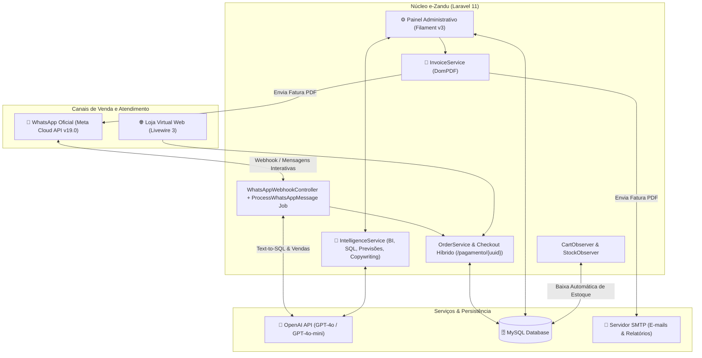
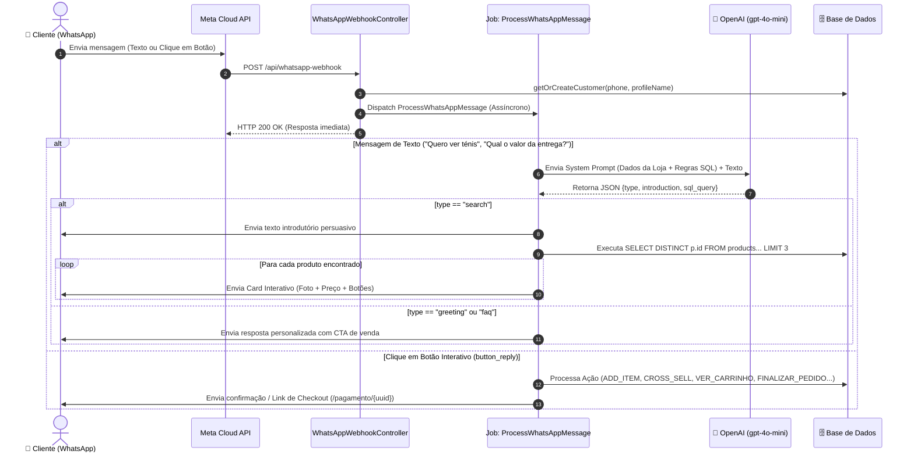

# 🛍️ e-Zandu — Plataforma Inteligente de E-Commerce, ERP, BI com IA e Vendas por WhatsApp

O **e-Zandu** é uma solução *all-in-one* de **Comércio Eletrónico, Gestão de Estoque e Compras (ERP), CRM, Automação de Marketing e Business Intelligence (BI) assistido por Inteligência Artificial**, desenhada com suporte completo a logística por províncias e múltiplos métodos de pagamento (Transferência Bancária / IBAN, Multicaixa Express e Pagamento na Entrega).

Além da Loja Virtual Web moderna e do Backoffice Administrativo completo, o **e-Zandu** conta com um **Agente de Vendas Inteligente no WhatsApp** (integrado à API Oficial da Meta e OpenAI), capaz de atender clientes 24/7, pesquisar produtos no banco de dados em linguagem natural, apresentar catálogos interativos com fotos e botões, sugerir *cross-sell*, gerir carrinhos, emitir faturas em PDF e notificar reposições de estoque automaticamente.

---

## 📑 Índice

1. [Visão Geral e Arquitetura](#-visão-geral-e-arquitetura)
2. [Stack Tecnológica](#-stack-tecnológica)
3. [Módulos Principais do Sistema](#-módulos-principais-do-sistema)
4. [Recursos de Inteligência Artificial e BI](#-recursos-de-inteligência-artificial-e-bi)
5. [Bot de Vendas e Integração com WhatsApp](#-bot-de-vendas-e-integração-com-whatsapp)
6. [Modelo SaaS e Planos de Subscrição](#-modelo-saas-e-planos-de-subscrição)
7. [Tarefas Agendadas e Filas (Cron & Queues)](#-tarefas-agendadas-e-filas-cron--queues)
8. [Instalação e Configuração](#-instalação-e-configuração)
9. [Estrutura de Diretórios Relevante](#-estrutura-de-diretórios-relevante)

---

## 🏗️ Visão Geral e Arquitetura



---

## 🚀 Stack Tecnológica

| Camada | Tecnologia / Pacote | Finalidade |
| :--- | :--- | :--- |
| **Framework Base** | Laravel 11.x (PHP 8.2+) | Arquitetura MVC, Filas, Eventos, Comandos e APIs |
| **Backoffice / ERP** | Filament PHP v3.2 | Painel administrativo rico, Dashboards, Tabelas, Infolists e Ações |
| **Frontend da Loja** | Livewire 3.6 + Blade + Vite | Loja reativa, Carrinho, Checkout Web, Checkout WhatsApp e Área do Cliente |
| **Inteligência Artificial** | OpenAI API (`gpt-4o` & `gpt-4o-mini`) | Assistente de vendas no WhatsApp, Text-to-SQL, Previsão de Vendas, Insights e Campanhas |
| **Mensageria Oficial** | Meta WhatsApp Cloud API (`v19.0`) | Envio/recepção de texto, botões interativos, imagens e faturas PDF |
| **Documentos & PDFs** | `barryvdh/laravel-dompdf` | Geração de faturas fiscais/comerciais, relatórios de vendas e alertas de stock |
| **Segurança & Perfis** | RBAC Customizado + `filament-multi-2fa` | Controle granular de Perfis (`Role`), Permissões (`Permission`) e Autenticação 2FA |
| **Backups** | `spatie/laravel-backup` | Rotina diária automatizada de backup da base de dados e ficheiros |

---

## 📦 Módulos Principais do Sistema

### 1. Loja Virtual (Frontend Público)
- **Catálogo Completo (`/`, `/loja`, `/produto/{slug}`):** Listagem com filtros, preços promocionais, variações de tamanhos e cores, galeria de fotos e avaliações de clientes (`ProductReview`).
- **Carrinho e Checkout Web (`/carrinho`, `/checkout`):** Cálculo automático de subtotal, aplicação de cupões de desconto (percentual ou valor fixo), escolha da província/taxa de entrega (`ShippingRate`) e método de pagamento (`PaymentMethod`).
- **Upload de Comprovativo (`/site/pagamento/{cartId}`):** Suporte nativo ao fluxo de pagamento por **Transferência Bancária (IBAN)** ou **Multicaixa Express**, com submissão de comprovativo (PDF/Imagem) para validação, além de **Pagamento na Entrega (Cash on Delivery)**.
- **Portal do Cliente (`/minha-conta`, `/minha-conta/pedidos`):** Histórico de encomendas, rastreamento de estado do pagamento e da entrega, e gestão de dados pessoais.

### 2. Gestão Comercial e Vendas (Backoffice Filament)
- **Gestão de Pedidos (`OrderResource` / `ViewOrder`):**
  - Visualização detalhada do pedido, itens, endereço/ponto de referência, notas do cliente e anexo do comprovativo de pagamento.
  - **Fluxo de Aprovação e Auditoria:** Regista automaticamente qual administrador executou cada ação e a respetiva data/hora (`payment_confirmed_by`, `payment_confirmed_at`, `delivery_confirmed_by`, `delivery_confirmed_at`, `rejected_by`, `rejected_at`).
  - **Ações Rápidas:** Confirmar Pagamento (gera fatura PDF e envia por WhatsApp/E-mail), Confirmar Entrega (notifica cliente no WhatsApp/E-mail), Rejeitar Comprovativo (com motivo) e Exportação de relatórios em Excel/PDF.
- **Catálogo, Cupões e Fretes:** Gestão de Produtos (com associação de *Cross-Sell*), Categorias, Marcas, Cupões de Desconto (com limite de uso e validade), Taxas de Entrega por Província e Métodos de Pagamento.

### 3. Gestão de Estoque Multi-Armazém, Compras e Finanças (ERP)
- **Multi-Armazém (`Stock` & `StockObserver`):** Suporte a múltiplos armazéns com definição de um **Armazém Padrão (`is_default = true`)** de onde saem as vendas online e do WhatsApp.
- **Movimentações e Baixa Automática (`StockMovement` & `CartObserver`):**
  - Antes de aprovar um pagamento (`status: active -> paid`), o `CartObserver` verifica se há saldo suficiente de todos os itens no Armazém Padrão. Caso não haja, bloqueia a aprovação e exibe um alerta detalhado ao operador.
  - Assim que o pagamento é confirmado, cria automaticamente os movimentos de saída (`type = 'sale'`) vinculados ao número do pedido.
- **Compras a Fornecedores (`Purchase`, `PurchaseItem`, `Supplier`):** Registo de entradas de mercadoria, impostos, frete e anexos de faturas de fornecedores (`PurchaseAttachment`).
- **Despesas Operacionais (`Expense`):** Controlo financeiro de custos da operação.

---

## 🧠 Recursos de Inteligência Artificial e BI

Centralizados no serviço [`App\Services\IntelligenceService`](app/Services/IntelligenceService.php) e integrados às páginas do painel Filament:

### 1. Chat de Análise de Dados — Text-to-SQL (`ChatAnalysis`)
Permite que o gestor faça perguntas em linguagem natural (ex: *"Quais foram os 10 produtos mais vendidos este mês em Luanda?"* ou *"Qual o total faturado por método de pagamento nos últimos 30 dias?"*).
- **Introspecção Dinâmica do Schema (`getDynamicSchema`):** A IA lê a estrutura real das tabelas permitidas (`products`, `carts`, `cart_items`, `users`, `stocks`, `purchases`, `expenses`, etc.), mantida em cache por 24h.
- **Guardrail de Segurança (`isSafeQuery`):** Bloqueia rigorosamente qualquer instrução SQL que não seja `SELECT` ou que contenha palavras-chave destrutivas (`DELETE`, `UPDATE`, `DROP`, `ALTER`, `TRUNCATE`, `INSERT`, etc.).
- **Execução + Análise Executiva:** Executa a query na base de dados, exibe a tabela de resultados e envia uma amostra de volta ao `gpt-4o` para redigir um **Resumo Executivo** e **Insights Acionáveis**.
- **Relatórios Guardados (`SavedReport`):** Permite guardar consultas geradas pela IA e agendar o seu envio automático por e-mail (`diário`, `semanal` ou `mensal`).

### 2. Previsão de Vendas com Data Science IA (`IntelligentAnalysis`)
- Extrai o histórico mensal de vendas pagas dos últimos **24 meses** e utiliza o `gpt-4o` em modo JSON estruturado para projetar a **previsão de faturação dos próximos 6 meses**, acompanhada de análise de sazonalidade, tendências de crescimento/queda e gráficos comparativos no painel.

### 3. Análise de Comportamento e *Cross-Sell* (`CustomerBehaviorAnalysis`)
- Executa queries de afinidade (*Market Basket Analysis*) sobre os últimos 90 dias para descobrir quais pares de produtos (`Produto A` + `Produto B`) são mais comprados juntos no mesmo pedido.
- A IA gera recomendações práticas de criação de *bundles*/kits promocionais e configuração de *upsell*.

### 4. Assistente Proativo de Insights de Negócio (`BusinessInsights`)
- Analisa automaticamente 4 pilares de KPIs:
  1. Comparação de vendas semanais (últimos 7 dias vs. 7 dias anteriores).
  2. Top 5 produtos geradores de receita (30 dias).
  3. Top 5 clientes mais valiosos / VIPs (30 dias).
  4. Produtos em risco imediato de rutura de stock (`stock < 10`).
- Também pode ser enviado semanalmente por e-mail através do comando agendado `ai:generate-insights`.

### 5. Copywriter IA para Campanhas de Marketing (`CampaignResource`)
- Através do método `generateCampaignTemplates()`, o gestor descreve o objetivo da campanha (promoção de produtos ou cupão de desconto) e a IA redige automaticamente:
  - **Template curto e persuasivo para WhatsApp** (com links diretos dos produtos/loja, preços originais vs. promocionais e variáveis `{nomeCliente}` e `{cupao}`).
  - **Assunto e Corpo de E-mail** prontos para disparo em massa via fila (`SendCampaignJob`).

---

## 💬 Bot de Vendas e Integração com WhatsApp

A integração com o WhatsApp utiliza a **Meta WhatsApp Cloud API (`v19.0`)** e opera de ponta a ponta como um canal de e-commerce conversacional completo.

### Arquitetura e Fluxo de Mensagens



### Funcionalidades Detalhadas do Bot no WhatsApp

#### 1. Registo Automático e Zero Fricção (`getOrCreateCustomer`)
- Ao enviar a primeira mensagem para o número da loja, o cliente é automaticamente registado na tabela `users` (model `Customer`, com `role = 'customer'`), capturando o nome do perfil do WhatsApp.
- A sua conta no portal web fica imediatamente pronta, tendo o próprio número de telefone como utilizador e senha inicial.

#### 2. Classificação Inteligente e Pesquisa *Text-to-SQL* (`processTextMessage`)
O bot injeta no prompt da OpenAI (`gpt-4o-mini`) o contexto atualizado da loja (em cache de 5 minutos): nome e descrição da loja, categorias, cupões ativos, métodos de pagamento com instruções e taxas/prazos de entrega de cada província. A IA responde sempre num contrato JSON estrito com 3 modos:
- **`search` (Busca de Produtos):**
  - Prioriza busca por nome/descrição (`p.name LIKE '%termo%' OR p.short_description LIKE '%termo%'`) ou por categoria (`JOIN categories`).
  - Executa a consulta SQL (`LIMIT 3`) e dispara um **Card Interativo (`sendProductCardMessage`)** para cada produto, contendo:
    - **Header:** Imagem principal do produto.
    - **Body:** Nome, descrição curta, preço (destacando preço promocional se existir), tamanhos e cores disponíveis, e status do stock no Armazém Padrão.
    - **Botões Interativos:**
      - Se houver stock: `🛒 Adicionar` (`ADD_ITEM_{id}`), `Mais Detalhes` (`MORE_DETAILS_{id}`) e `Ver Mais Imagens` (`MORE_IMAGES_{id}`).
      - Se estiver sem stock: `Avisar quando chegar` (`ACTIVATE_STOCK_ALERT_{id}`).
- **`greeting` (Saudação):** Cumprimenta o cliente pelo nome e convida-o ativamente para pesquisar produtos.
- **`faq` (Dúvidas sobre a Loja & Coerência):** Responde sobre prazos e custos de entrega por província, métodos de pagamento ou cupões ativos terminando sempre com um *Call-to-Action* (CTA). Se o cliente enviar mensagens aleatórias ou fora do contexto da loja, responde educadamente mantendo o foco comercial.

#### 3. Ações por Botões Interativos (`handleInteractiveMessage`)
| ID do Botão | Ação Executada pelo Bot |
| :--- | :--- |
| `ADD_ITEM_{id}` | Adiciona 1 unidade ao carrinho ativo do cliente (`OrderService::addItemToCart`). Se o produto possuir recomendações de **Cross-Sell**, envia imediatamente uma oferta com foto do produto complementar (`ADD_CROSS_SELL_{id}` / `REJECT_CROSS_SELL`). |
| `ADD_CROSS_SELL_{id}` | Adiciona o produto complementar sugerido ao carrinho e exibe os botões de finalização. |
| `MORE_DETAILS_{id}` | Envia a descrição completa do produto, tamanhos, cores e botões para adicionar ao pedido ou ver o carrinho. |
| `MORE_IMAGES_{id}` | Envia todas as fotos da galeria do produto (`ProductImage`) ordenadas por `sort_order` e pergunta se o cliente deseja adicioná-lo ao pedido. |
| `ACTIVATE_STOCK_ALERT_{id}` | Cria um registo em `stock_alerts` para avisar o cliente no WhatsApp assim que o produto voltar ao estoque. |
| `VER_CARRINHO` | Lista todos os itens do carrinho ativo, quantidades, subtotais e total, com botões `Finalizar Pedido Já` e `Atualizar Carrinho`. |
| `FINALIZAR_PEDIDO` | Verifica se o cliente tem nome preenchido, gera o `uuid` do carrinho e envia o link exclusivo do **Checkout WhatsApp (`/pagamento/{uuid}`)** + credenciais de acompanhamento no portal web. |

#### 4. Checkout Híbrido do WhatsApp (`WhatsappCheckout` / `PaymentController`)
Quando o cliente clica no link `/pagamento/{uuid}` enviado no WhatsApp:
- Abre uma interface limpa e rápida (focada em mobile) já com todos os itens que ele adicionou na conversa do WhatsApp.
- O cliente seleciona a província de entrega, informa a morada/ponto de referência, adiciona notas opcionais (como tamanho/cor desejados), aplica cupão de desconto e anexa o comprovativo de pagamento (PDF/JPG/PNG).
- Assim que submetido, **o Administrador recebe imediatamente uma notificação no seu WhatsApp e no sino do Painel Filament (`WhatsAppService::notifyAdmin`)** com o resumo financeiro e link direto do comprovativo.

#### 5. Pós-Venda, Faturas PDF, Alertas de Stock e Campanhas no WhatsApp
- **Envio Automático de Fatura PDF:** Quando o administrador confirma o pagamento no painel (`ViewOrder`), o `InvoiceService` gera a fatura em PDF com o logotipo da loja e o `WhatsAppService::sendDocumentMessage()` envia o documento PDF diretamente para o WhatsApp do cliente, seguido da mensagem de confirmação.
- **Aviso de Entrega:** Ao confirmar a entrega no painel, o cliente recebe automaticamente uma mensagem no WhatsApp informando que o pedido foi entregue.
- **Notificação de Reposição de Stock (`ProcessStockAlerts`):** Quando um produto esgotado recebe entrada de stock no Armazém Padrão, o comando `stock:process-alerts` envia uma mensagem interativa no WhatsApp de todos os clientes que clicaram em *"Avisar quando chegar"*, já com a foto do produto e o botão **`Comprar Agora` (`ADD_ITEM_{id}`)**.
- **Disparo de Campanhas (`SendCampaignJob`):** Envia campanhas promocionais segmentadas para o WhatsApp e/ou E-mail dos clientes registados.

---

## 🔐 Modelo SaaS e Planos de Subscrição

O [`SubscriptionManager`](app/Services/SubscriptionManager.php) controla o acesso aos módulos do painel e às tarefas agendadas com base no plano ativo (`SubscriptionDetail`):

| Plano | Funcionalidades Incluídas |
| :--- | :--- |
| **Trial (`trial`)** | **Recursos Core:** Dashboard Analítico, Clientes, Vendas, Cupões, Avaliações, Taxas de Frete, Produtos, Categorias, Fornecedores, Armazéns, Compras, Despesas Operacionais, Métodos de Pagamento, Administradores/Perfis, Configurações da Loja, Personalização e Alertas de Stock Baixo por E-mail. |
| **Essencial (`essencial`)** | Tudo do *Trial* + **Módulos de IA e BI:** Assistente de Insights (`BusinessInsights`), Chat de Análise SQL (`ChatAnalysis`), Análise de Comportamento/Cross-Sell (`CustomerBehaviorAnalysis`), Relatórios Guardados/Agendados (`SavedReport`) e Análise Inteligente/Previsão de Vendas (`IntelligentAnalysis`). |
| **PRO (`pro`)** | Tudo do *Essencial* + **Automação de Marketing e Alertas Avançados:** Gestão e Disparo de Campanhas Multi-Canal (`CampaignResource` / WhatsApp & E-mail) e Processamento Automático de Alertas de Reposição de Stock para Clientes no WhatsApp (`stock:process-alerts`). |

---

## ⏱️ Tarefas Agendadas e Filas (Cron & Queues)

Configuradas em [`app/Console/Kernel.php`](app/Console/Kernel.php):

| Comando Artisan | Frequência | Plano Mínimo | Descrição |
| :--- | :--- | :--- | :--- |
| `queue:work --queue=campaigns,default --stop-when-empty` | A cada minuto | Todos | Processa os jobs da fila (mensagens do WhatsApp e disparos de campanhas). |
| `stock:send-alerts` | Diário às `08:00` | Todos (Core) | Verifica produtos abaixo do stock mínimo e envia relatório PDF por e-mail aos gestores. |
| `backup:clean` / `backup:run` | Diário (`01:00` / `01:30`) | Todos (Core) | Limpa backups antigos e executa novo backup da aplicação/BD. |
| `app:send-scheduled-reports` | Diário, Semanal e Mensal (`08:00`) | Essencial | Executa e envia por e-mail os relatórios guardados (`SavedReport`). |
| `ai:generate-insights` | Segundas-feiras às `07:00` | Essencial | Gera insights proativos de negócio com IA e envia aos administradores. |
| `ai:generate-campaigns` | Terças-feiras às `07:00` | Essencial | Sugere e prepara campanhas automáticas baseadas em IA. |
| `ai:generate-reports` / `ai:train-models` | Diário (`06:00`) / Mensal (`02:00`) | Essencial | Atualiza relatórios analíticos e modelos de previsão. |
| `campaign:dispatch-scheduled` | A cada minuto | PRO | Despacha campanhas de marketing agendadas (`scheduled_at`). |
| `stock:process-alerts` | A cada 10 minutos | PRO | Notifica clientes no WhatsApp e E-mail quando produtos desejados voltam ao stock. |

---

## 🛠️ Instalação e Configuração

### Pré-requisitos
- **PHP** >= 8.2 (com extensões `mbstring`, `xml`, `gd`, `curl`, `pdo_mysql`, `fileinfo`, `zip`)
- **Composer** 2.x
- **Node.js** >= 18.x & **NPM**
- **MySQL** / MariaDB

### Passo a Passo

1. **Clonar o repositório e instalar dependências:**
   ```bash
   git clone <url-do-repositorio> e-zandu
   cd e-zandu
   composer install
   npm install && npm run build
   ```

2. **Configurar o ficheiro de ambiente (`.env`):**
   ```bash
   cp .env.example .env
   php artisan key:generate
   ```

3. **Configurar as variáveis da Base de Dados, OpenAI e WhatsApp no `.env`:**
   ```env
   APP_NAME="e-Zandu"
   APP_URL=https://seudominio.ao

   DB_CONNECTION=mysql
   DB_HOST=127.0.0.1
   DB_PORT=3306
   DB_DATABASE=ezandu
   DB_USERNAME=root
   DB_PASSWORD=

   QUEUE_CONNECTION=database

   # --- Inteligência Artificial (OpenAI) ---
   OPENAI_API_KEY="sk-..."

   # --- Meta WhatsApp Cloud API (v19.0) ---
   WHATSAPP_API_TOKEN="EAAG..."
   WHATSAPP_PHONE_ID="1029384756..."
   WHATSAPP_VERIFY_TOKEN="seu_token_secreto_de_verificacao"
   ADMIN_WHATSAPP_NUMBER="2449XXXXXXXX"
   ```

4. **Executar as migrações, seeders e criar o link simbólico do storage:**
   ```bash
   php artisan migrate --seed
   php artisan storage:link
   ```

5. **Configurar o Webhook na Meta for Developers:**
   - **Callback URL:** `https://seudominio.ao/api/whatsapp-webhook`
   - **Verify Token:** O mesmo valor definido em `WHATSAPP_VERIFY_TOKEN` no `.env`.
   - **Campos subscritos:** `messages`.

6. **Iniciar a aplicação e o agendador de tarefas (Cron):**
   - Em desenvolvimento:
     ```bash
     php artisan serve
     php artisan queue:work --queue=campaigns,default
     ```
   - Em produção, adicione ao `crontab` do servidor:
     ```cron
     * * * * * cd /caminho/para/e-zandu && php artisan schedule:run >> /dev/null 2>&1
     ```

---

## 📂 Estrutura de Diretórios Relevante

```text
e-zandu/
├── app/
│   ├── Console/Commands/           # Comandos de IA, alertas de stock, relatórios e campanhas
│   ├── Filament/
│   │   ├── Pages/                  # Dashboards de BI, Chat SQL, Insights, Previsão e Cross-Sell
│   │   ├── Resources/              # CRUDs administrativos (Vendas, Produtos, Stock, Compras, etc.)
│   │   └── Widgets/                # Gráficos de vendas, métodos de pagamento, províncias e stock baixo
│   ├── Http/Controllers/
│   │   ├── Api/WhatsAppWebhookController.php  # Cérebro do Bot WhatsApp (OpenAI + Botões Interativos)
│   │   ├── PaymentController.php              # Submissão de comprovativos e cálculo de cupões
│   │   └── WebhookController.php              # Webhook de atualização de subscrição SaaS
│   ├── Jobs/
│   │   ├── ProcessWhatsAppMessage.php         # Processamento assíncrono de mensagens do WhatsApp
│   │   └── SendCampaignJob.php                # Disparo de campanhas por WhatsApp e E-mail
│   ├── Livewire/Site/
│   │   ├── Checkout/WhatsappCheckout.php      # Checkout exclusivo para clientes vindos do WhatsApp
│   │   └── Defaults/                          # Loja Virtual (Home, Shop, Cart, Checkout, Minha Conta)
│   ├── Models/                     # Modelos Eloquent (Cart, Product, Customer, Stock, Setting, etc.)
│   ├── Observers/
│   │   ├── CartObserver.php        # Validação e baixa automática de stock ao aprovar pagamento
│   │   └── StockObserver.php       # Garantia de Armazém Padrão único
│   └── Services/
│       ├── IntelligenceService.php # Serviço central de IA (Text-to-SQL, Previsões, Insights, Copy)
│       ├── InvoiceService.php      # Geração de faturas em PDF
│       ├── OrderService.php        # Lógica de carrinho ativo e formatação de valores
│       ├── ReportService.php       # Execução de relatórios guardados
│       ├── SubscriptionManager.php # Gestão de planos SaaS (Trial, Essencial, PRO)
│       └── WhatsAppService.php     # Cliente HTTP para a Meta WhatsApp Cloud API v19.0
├── routes/
│   ├── api.php                     # Endpoints de Webhook (WhatsApp e Subscrição)
│   ├── core.php                    # Rotas administrativas e avisos de subscrição
│   └── default.php                 # Rotas públicas da loja e área do cliente
└── resources/views/                # Templates Blade (Loja, Painel Filament, Faturas PDF e E-mails)
```

---

## 📄 Licença

Este projeto é distribuído sob a licença [MIT](https://opensource.org/licenses/MIT).
